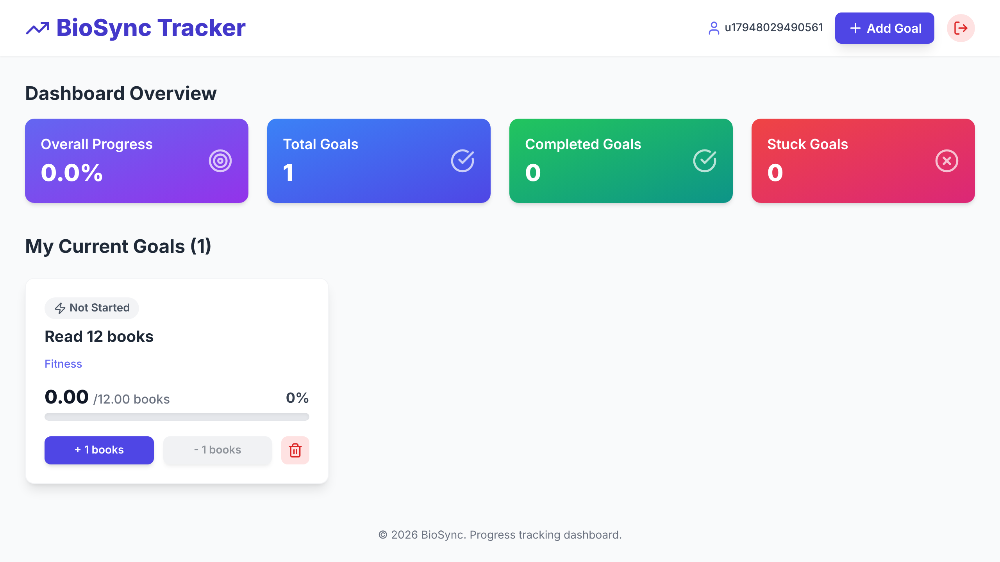

# 💪 BioSync

**A full-stack fitness and goal-tracking app.** Set measurable goals, log progress against them, and record workouts and biometrics. It has a Django REST API backend and a React + Tailwind dashboard.

[](https://www.djangoproject.com/)
[](https://www.django-rest-framework.org/)
[](https://react.dev/)
[](https://vitejs.dev/)
[](https://tailwindcss.com/)
[](https://www.postgresql.org/)
[](https://www.docker.com/)
[](LICENSE)



## ✨ Features

**Web dashboard (`biosync-web`)**
- Register and sign in (token authentication)
- Overview cards: overall progress, total goals, completed goals and stuck goals
- Create goals with a target value and unit (km, books, hours…), a type and dates
- Update progress with one click (`+1` / `-1`) and watch the progress bar fill
- Delete goals

**REST API (`biosync-backend`)**
- **Users**: custom user model with email login, UUID ids, and fitness profile fields (fitness level, height, weight, date of birth, bio)
- **Goals**: CRUD scoped to the signed-in user, an automatic `progress_percentage`, and a `complete` action
- **Progress entries**: dated entries that update their goal's `current_value` and status
- **Activities**: workouts with nested exercise and set logs, plus biometric records
- Every endpoint except register and login requires authentication

## 🛠️ Tech stack

| Layer | Tools |
| --- | --- |
| Backend | Python, Django 4.2, Django REST Framework, token auth, django-cors-headers |
| Database | SQLite by default; PostgreSQL when `DB_NAME` is set |
| Frontend | React 18, Vite, Tailwind CSS, lucide-react icons |
| DevOps | Docker (backend), `concurrently` to run both apps at once |

## 📂 Project structure

```
BioSync-PWA/
├── biosync-backend/          # Django REST API
│   ├── biosync/              # settings, urls, wsgi/asgi
│   ├── apps/
│   │   ├── users/            # custom user, register, login, profile
│   │   ├── goals/            # goals + progress percentage
│   │   ├── progress/         # dated progress entries
│   │   └── activities/       # workouts, exercises, sets, biometrics
│   ├── requirements.txt
│   └── Dockerfile
├── biosync-web/              # React + Vite + Tailwind dashboard
│   └── src/App.jsx
└── package.json              # scripts to run both apps
```

## 🚀 Getting started

**You need:** Python 3.11+ and Node.js 18+.

### 1. Backend

```bash
git clone https://github.com/Dwaynemaster007/BioSync-PWA.git
cd BioSync-PWA/biosync-backend
python -m venv venv && source venv/bin/activate   # Windows: venv\Scripts\activate
pip install -r requirements.txt
python manage.py migrate
python manage.py runserver                        # http://localhost:8000
```

With no `.env` file it uses SQLite and safe development defaults. To use PostgreSQL, copy `.env.example` to `.env` and fill in the `DB_*` values.

### 2. Frontend

```bash
cd ../biosync-web
npm install
npm run dev                                       # http://localhost:3000
```

The app calls `http://localhost:8000/api/v1` by default. To point it somewhere else, set `VITE_API_BASE_URL` in `biosync-web/.env`.

### Or run both at once

From the repo root:

```bash
npm install
npm run dev
```

### Docker (backend only)

```bash
cd biosync-backend
docker build -t biosync-backend .
docker run -p 8000:8000 biosync-backend
```

## 📡 API reference

Base URL: `/api/v1`. Send `Authorization: Token <token>` on every request except register and login.

| Method | Endpoint | Description |
| --- | --- | --- |
| `POST` | `/users/register/` | Create an account (`email`, `username`, `password`, `password2`) and get a token back |
| `POST` | `/users/login/` | Log in with `email` (or `username`) and `password`, and get a token back |
| `GET` `PATCH` | `/users/profile/` | View or update your profile |
| `GET` `POST` | `/goals/` | List or create goals |
| `GET` `PUT` `PATCH` `DELETE` | `/goals/{id}/` | Manage one goal |
| `POST` | `/goals/{id}/complete/` | Mark a goal as completed |
| `GET` `POST` | `/progress/` | List or add progress entries (one per goal per day) |
| `GET` `PUT` `PATCH` `DELETE` | `/progress/{id}/` | Manage one entry |
| `GET` `POST` | `/activities/workouts/` | List or log workouts |
| `GET` `POST` | `/activities/biometrics/` | List or record biometric data |

Example:

```bash
curl -X POST http://localhost:8000/api/v1/goals/ \
  -H "Authorization: Token <token>" -H "Content-Type: application/json" \
  -d '{"title":"Run 100 km","start_date":"2026-11-01","target_value":"100","target_unit":"km","goal_type":"Fitness"}'
```

## ⚙️ Environment variables (backend)

| Variable | Default | Description |
| --- | --- | --- |
| `SECRET_KEY` | dev-only key | Django secret key. **Set this in production.** |
| `DEBUG` | `True` | Set to `False` in production |
| `ALLOWED_HOSTS` | `127.0.0.1,localhost` | Comma-separated hosts |
| `CORS_ALLOWED_ORIGINS` | `http://localhost:3000,http://127.0.0.1:3000` | Frontend origins that may call the API |
| `DB_NAME`, `DB_USER`, `DB_PASSWORD`, `DB_HOST`, `DB_PORT` | none | Set these to use PostgreSQL instead of SQLite |

## 🗺️ Roadmap

- [ ] Workout logging screens in the web app (the API is ready)
- [ ] [WGER](https://wger.de/en/software/api) exercise database integration
- [ ] Progress charts and workout history
- [ ] PWA support: installable, works offline, push reminders
- [ ] React Native mobile app
- [ ] Workout plans, nutrition tracking and leaderboards
- [ ] Dark mode
- [ ] Deployment (Vercel + Render)

## 👤 Author

**Thubelihle Dlamini**, [GitHub](https://github.com/Dwaynemaster007) · [LinkedIn](https://linkedin.com/in/thubelihledlamini)

## 📄 License

[MIT](LICENSE)
